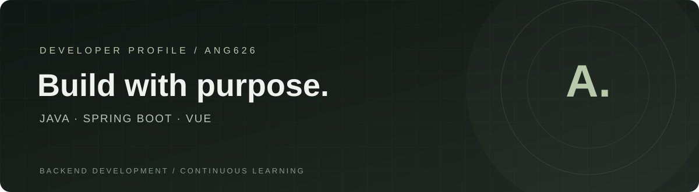

 

**Java · Spring Boot · Vue**

 

<a href="https://ang626.github.io">Portfolio</a>
&nbsp; / &nbsp;
<a href="https://github.com/ang626">GitHub</a>

---

### About

Java와 Spring 기반의 백엔드 개발을 중심으로 공부하고 있습니다.  
Vue를 이용한 화면 개발까지 직접 연결하며 프로젝트를 만들고 있습니다.

### Tech

  
  
  
  
  
  
  

### Projects

| Project | Description | Stack |
|:--|:--|:--|
| [차량 관리](https://github.com/ang626/car-project) | 차량 관리 프로젝트 | Java · Spring Boot · Vue · MariaDB |
| [악기 연습](https://github.com/ang626/musicpractice-project) | 악기 연습 프로젝트 | Java · Spring Boot · Vue · MySQL |
| [Portfolio](https://ang626.github.io) | 개인 포트폴리오 웹사이트 | HTML · CSS · JavaScript |

---

  꾸준히 만들고, 배우고, 개선합니다.

